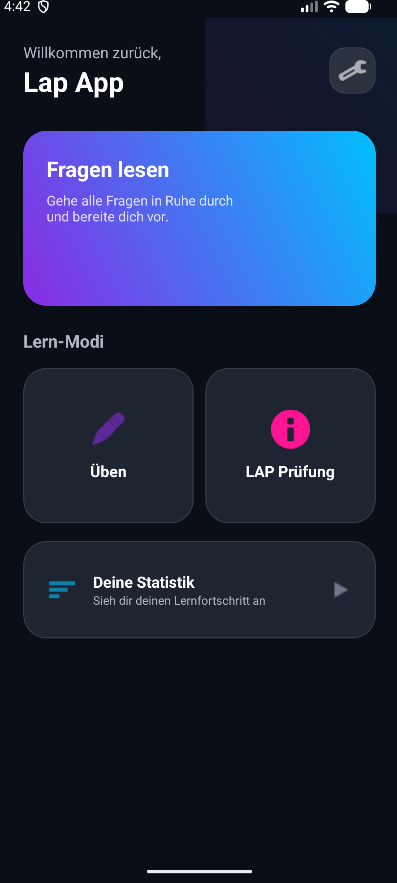
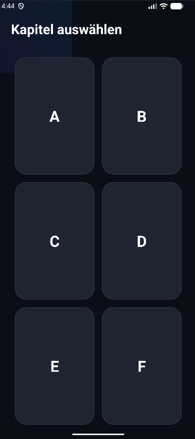
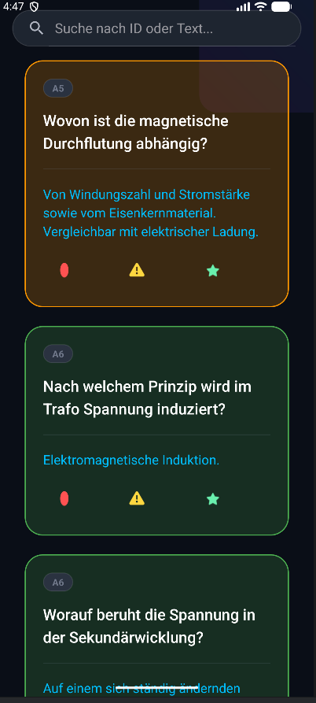
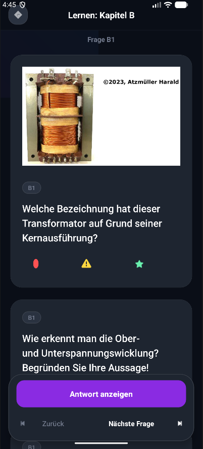
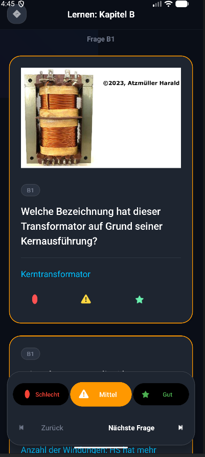
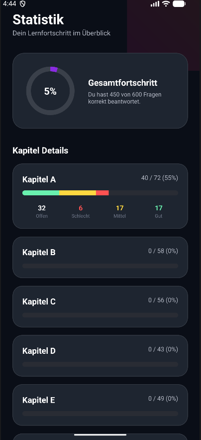
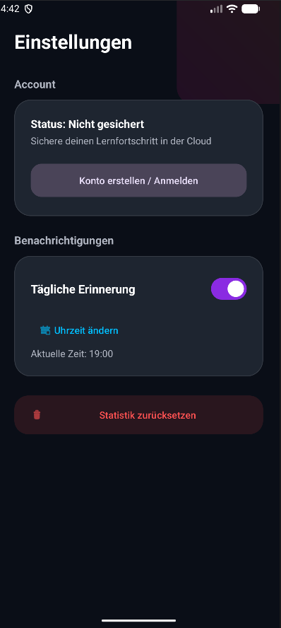
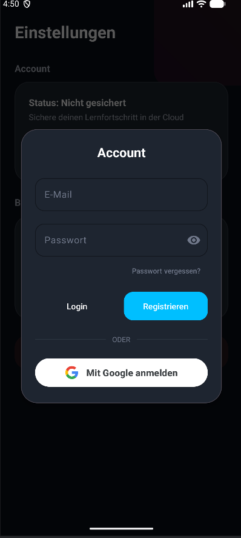

# ⚡ Lap App – Elektrotechnik Quiz & LAP-Vorbereitung


Eine moderne, elegante Android-App zur gezielten Vorbereitung auf die **Lehrabschlussprüfung (LAP) für Anlagen- und Betriebstechniker in Österreich**. Die App bietet strukturiertes Lernen nach Prüfungs-Kapiteln, Echtzeit-Statistiken, ein dynamisches Bewertungssystem und ein dunkles Glassmorphism-Design.

> ℹ️ **Hinweis zur Plattform:** Diese App ist vorerst **ausschließlich für Android-Smartphones und -Tablets** verfügbar.

---

## 📥 APK Download (Direkt-Installation)

Du kannst die fertige App direkt herunterladen und auf deinem Android-Smartphone installieren:

- 🟢 **[Download LapApp.apk (Direkt-Download)](https://github.com/Yachi-qwq/Lap-App/raw/main/releases/LapApp.apk)**

*Hinweis zur Installation:* Auf Android-Geräten muss bei der ersten Installation aus einer APK-Datei eventuell die Option *"Installation aus unbekannten Quellen zulassen"* in den Einstellungen aktiviert werden.

---

## 📱 Screenshots

<div style="text-align: center;">

| Hauptmenü | Kapitelauswahl | Fragen lesen |
| :---: | :---: | :---: |
|  |  |  |

| Lernmodus (Frage) | Lernmodus (Antwort & Bewertung) | Statistik & Fortschritt |
| :---: | :---: | :---: |
|  |  |  |

| Einstellungen | Cloud-Backup & Account |
| :---: | :---: |
|  |  |

</div>

---

## ✨ Hauptfunktionen

### 📖 1. Fragen lesen & Durchsuchen
- Durchstöbere alle prüfungsrelevanten Fragen für die LAP Anlagen- und Betriebstechnik in Österreich.
- Live-Suchfunktion nach **Frage-ID** oder **Textinhalten**.
- Farbliche Hervorhebung von gelernten und nicht-gelernten Fragen.

### 🎯 2. Üben & Lernmodus
- Gehe Fragen Schritt für Schritt kapitelweise durch (Kapitel A bis F).
- Inklusive Schaltplänen, Diagrammen und Bauteilabbildungen aus der österreichischen Prüfungspraxis.
- Selbstbewertungssystem per Schalter:
  - 🔴 **Schlecht**: Frage erneut wiederholen.
  - 🟡 **Mittel**: Unsicherheiten vorhanden.
  - 🟢 **Gut**: Frage beherrscht.

### 🎲 3. LAP Prüfungsmodus
- Zufallsgenerierte Fragen aus allen Kapiteln oder gezielt aus einem ausgewählten Kapitel.
- Simulation unter realen LAP-Prüfungsbedingungen.

### 📊 4. Detaillierte Statistik & Drill-Down
- **Gesamtforschrittsanzeige** mit zirkulärem Fortschrittsbalken.
- Aufschlüsselung pro Kapitel (Offen, Schlecht, Mittel, Gut).
- **Drill-Down Modus**: Klicke direkt auf z. B. "Rot / Schlecht", um exakt die Fragen gezielt zu wiederholen.

### 🔔 5. Tägliche Erinnerung & Backup
- **Tägliche Push-Benachrichtigung** zur individuell einstellbaren Lernzeit.
- Automatischer Neustart der Benachrichtigungen nach einem Geräte-Neustart (`BOOT_COMPLETED`).
- Tägliche Hintergrund-Sicherung deines Fortschritts über den Android **WorkManager**.

---

## 🛠 Tech Stack & Architektur

| Komponente | Technologie / Bibliothek |
| :--- | :--- |
| **Plattform** | **Nur Android** (Android 11 bis Android 15) |
| **Programmiersprache** | Kotlin |
| **Min. SDK / Target SDK** | Android 11 (API 30) / Android 15 (API 36) |
| **UI Design System** | Material Design 3 (Glassmorphism, CardViews, Night Theme) |
| **Layouts** | ConstraintLayout, RecyclerView, MaterialCardView, Dynamic Themes |
| **Hintergrund-Tasks** | AndroidX `WorkManager`, `AlarmManager`, `BroadcastReceiver` |
| **Datenformat & Parser** | JSON (`fragen.json`), Google `Gson` |
| **Speicherung** | Android `SharedPreferences` |
| **Dependency Mgmt.** | Gradle Version Catalogs (`libs.versions.toml`) |

---

## 📁 Projektstruktur

```text
lapApp/
├── app/
│   ├── src/main/
│   │   ├── assets/
│   │   │   └── fragen.json               # Prüfungsfragen & Antworten im JSON-Format
│   │   ├── java/com/danielhuettel/lapapp/
│   │   │   ├── MainActivity.kt           # Hauptmenü & Navigation
│   │   │   ├── BaseActivity.kt           # Basis-Klasse für einheitliches Dark-Theme
│   │   │   ├── ChapterActivity.kt        # Auswahl der Prüfungskapitel (A–F)
│   │   │   ├── QuizActivity.kt           # Interaktiver Lern- & Prüfungsmodus
│   │   │   ├── DetailActivity.kt         # Lese-Modus mit Live-Suchfunktion
│   │   │   ├── StatisticsActivity.kt     # Auswertung & Kapitel-Drill-Down
│   │   │   ├── SettingsActivity.kt       # Einstellungen & Benachrichtigungen
│   │   │   ├── NotificationScheduler.kt  # Helper zur Einplanung von Alarmen
│   │   │   ├── AlarmReceiver.kt          # BroadcastReceiver für Push-Notifications
│   │   │   ├── BootReceiver.kt           # Autostart-Receiver nach Geräte-Neustart
│   │   │   ├── BackupWorker.kt           # WorkManager-Task für tägliches Fortschritts-Backup
│   │   │   ├── Question.kt               # Datenmodell für Prüfungsfragen
│   │   │   ├── QuestionAdapter.kt        # Adapter für Fragenlisten-Darstellung
│   │   │   └── LapQuestionAdapter.kt     # Adapter für interaktiven Quiz-Modus
│   │   └── res/                          # Layout-XMLs, Drawables, Styles & Vector-Icons
├── screenshots/                          # Screenshots für die Repository-Dokumentation
├── build.gradle.kts                      # Root Gradle Configuration
└── README.md                             # Projektdokumentation
```

---

## ⚙️ Technische Erklärung des Projekts

### 🏛️ 1. Zweck, Zielgruppe & Plattform
- **Zielgruppe**: Auszubildende und Prüfungskandidaten für die **Lehrabschlussprüfung (LAP) als Anlagen- und Betriebstechniker in Österreich**.
- **Plattform**: Die App wurde nativ für **Android** entwickelt (unterstützt Android 11 API 30 bis Android 15 API 36). Eine iOS-Version existiert vorerst nicht.

### 🏛️ 2. Architektur & Navigation
- **BaseActivity**: Vererbungshierarchie für alle Aktivitäten der App, um systemweit ein konsistentes Dark-Theme (`AppCompatDelegate.MODE_NIGHT_YES`) durchzusetzen.
- **MainActivity**: Dient als Hauptzentrale mit modernem Material3 Grid-Layout und steuert den Aufruf der verschiedenen Lernmodi (`READ`, `LEARN`, `LAP_ALL`, `LAP_CHAPTER`).
- **ChapterActivity**: Übergibt über Intent-Extras (`MODE`, `CHAPTER`) den gewählten Modus und steuert die Navigation zur passenden Ansicht.
- **QuizActivity**: Herzstück des Lernsystems. Unterstützt verschiedene Modi (Üben, Zufallsprüfung, Drill-Down) und verwaltet den Zustand der Fragen (Aufklappen von Antworten, Navigation vor/zurück, Speichern des Lernstatus).
- **StatisticsActivity**: Berechnet dynamisch die Statistiken pro Kapitel aus den gespeicherten Daten und ermöglicht per Klick auf die Farb-Segmente den gezielten Start des Drill-Downs.

### 📦 3. Datenhaltung & JSON-Parsing
- **Fragensammlung**: Alle Fragen zur LAP Anlagen- und Betriebstechnik sind als JSON in `app/src/main/assets/fragen.json` hinterlegt.
- **Deserialisierung**: Das Laden erfolgt asynchron mittels **Google Gson** über `TypeToken<List<Question>>`.
- **Dynamische Ressourcen**: Abbildungen (Schaltpläne, Bauteile) werden zur Laufzeit basierend auf der Frage-ID dynamisch über `resources.getIdentifier(imageName, "drawable", packageName)` geladen.

### 🔄 4. Adapter & UI-Rendern
- **QuestionAdapter**: Wird in der `DetailActivity` eingesetzt. Implementiert eine Live-Suche (`filter()`), die Fragen anhand ihrer ID oder des Textes filtert.
- **LapQuestionAdapter**: Spezialisierter Adapter für die `QuizActivity`. Unterstützt Ein-/Ausblenden der Antworten, Inline-Bewertungsschaltflächen und haptisches Feedback (`performHapticFeedback()`).
- **Status-Hervorhebung**: Der Bearbeitungsstatus einer Frage (Rot = 1, Gelb = 2, Grün = 3) verändert dynamisch die Rahmenfarbe und Strichstärke der `MaterialCardView`.

### 🔔 5. Hintergrundverarbeitung & Benachrichtigungen
- **NotificationScheduler**: Kapselt die Steuerung des Android `AlarmManager`. Plant tägliche RTC-WAKEUP Alarme für die festgelegte Uhrzeit.
- **AlarmReceiver**: Erzeugt bei Auslösung des Alarms einen Benachrichtigungskanal (`NotificationChannel`) für Android 8.0+ und zeigt die lokale Push-Benachrichtigung an.
- **BootReceiver**: Empfängt das `ACTION_BOOT_COMPLETED`-Signal des Systems und stellt nach einem Neustart des Smartphones automatisch alle Alarme und Backup-Tasks wieder her.
- **BackupWorker**: Verwendet AndroidX `WorkManager`, um einmal alle 24 Stunden im Hintergrund ein Backup des Lernfortschritts als JSON-Datei im internen App-Speicher abzulegen.

---

## 🚀 Installation & Quellcode bauen

1. **Repository klonen**:
   ```bash
   git clone https://github.com/DEIN_BENUTZERNAME/lapApp.git
   ```
2. **In Android Studio öffnen**:
   - Öffne Android Studio -> *File* -> *Open* -> Wähle den Ordner `lapApp`.
3. **Projekt bauen & ausführen**:
   - Schließe ein Android-Gerät an oder starte einen Emulator (Android 11 / API 30+).
   - Klicke auf **Run `app`** (`Shift + F10`).

---


